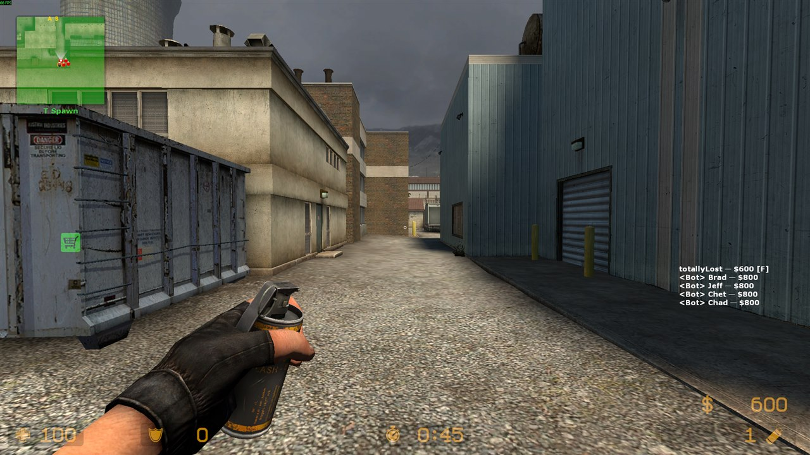
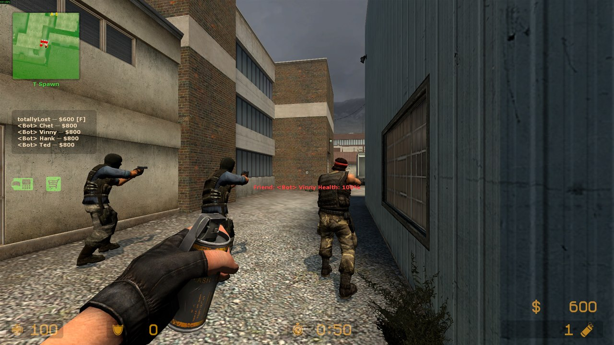
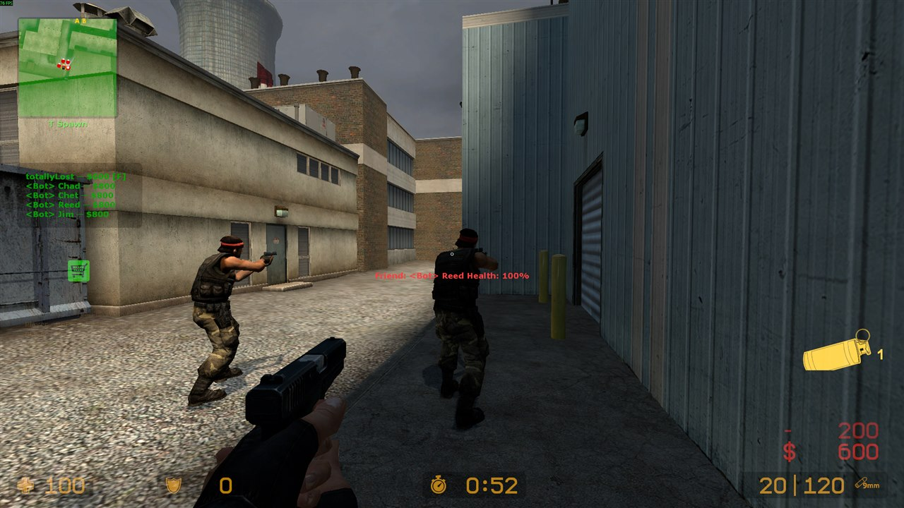
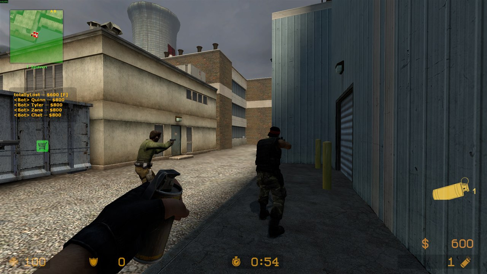
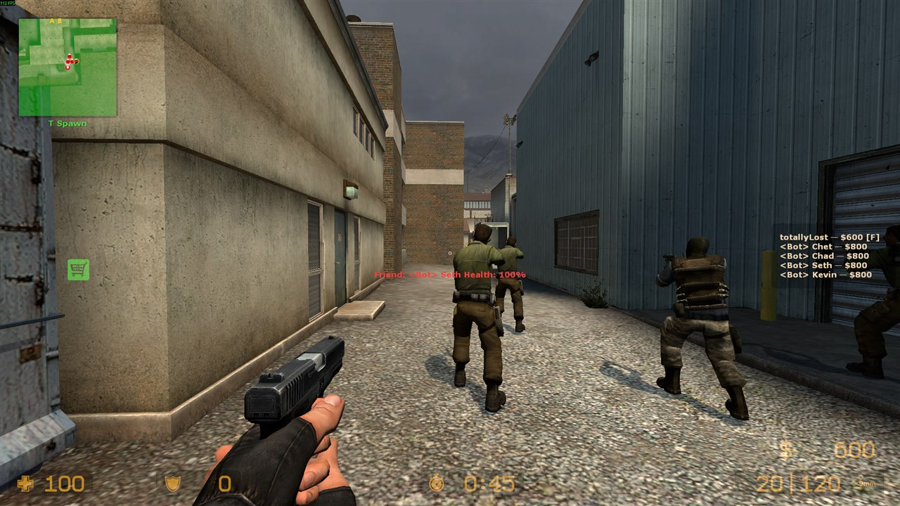
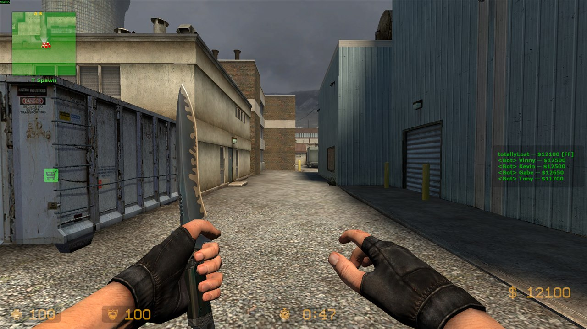
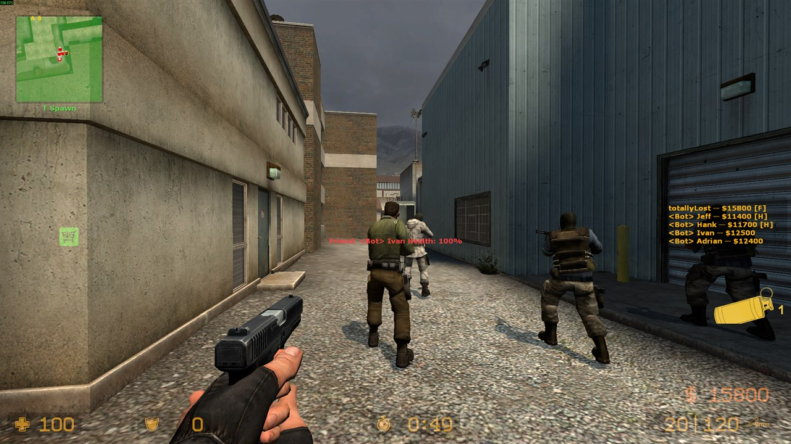

# teammoney — деньги и гранаты команды (CS:S)

[English version below](#english)

Слой: утилита. Зависимостей и публичного API нет.

Во время фризтайма и `sm_teammoney_extra_time` секунд после него показывает каждому игроку в KeyHintText (подсказка у края экрана) деньги, гранаты и наборы сапёра его команды, отсортированные по деньгам: `Ник — $4500 [FFHS|D]` (F — флешка, H — HE, S — дым, D — набор сапёра; без гранат — `[D]`). У мёртвых — только деньги и подпись «мёртв».

Подписи выводятся на языке игрока (en и ru); игроки с разными языками в одной команде видят каждый свой вариант.

Установка: `build/teammoney.smx` → `addons/sourcemod/plugins/`, `translations/` → `addons/sourcemod/translations/`.

| Квар | По умолчанию | Смысл |
|---|---|---|
| `sm_teammoney_enabled` | 1 | включить |
| `sm_teammoney_extra_time` | 5.0 | сколько секунд показывать после конца фризтайма |
| `sm_teammoney_interval` | 0.25 | период обновления |
| `sm_teammoney_name_length` | 12 | максимум символов ника |
| `sm_teammoney_debug` | 0 | лог в `logs/teammoney_debug.log` |

## Как это работает

- Показ начинается на `round_start` и заканчивается через `sm_teammoney_extra_time` секунд после `round_freeze_end`. Верхнего предела нет: при длинном фризтайме HUD висит всё время.
- Если плагин загружен или включён (`sm_teammoney_enabled 0 → 1`) посреди фризтайма, показ начинается сразу.
- HUD гаснет на 0,2 с позже расчётного времени: скрытие отправляется с задержкой, чтобы не обогнать последнее обновление.

## Внешний вид на клиенте (необязательно)

По умолчанию игра рисует KeyHintText белым текстом без фона у правого края экрана:

Для тех, кому это неудобно, в [релизах](https://github.com/Kolka2/css-plugins/releases) лежат шесть готовых VPK-файлов. Они меняют место, цвет текста и фон подсказки. Это файлы для игрока, а не для сервера: серверу и плагину они не нужны, каждый ставит их себе сам.

| | gray | green | orange |
|---|---|---|---|
| **left_radar** — слева, под радаром |  |  |  |
| **right_center** — справа, по центру по вертикали |  |  |  |

Файл называется `keyhint_<место>_<цвет>.vpk`, например `keyhint_left_radar_green.vpk`. Цвета взяты из стандартного HUD игры. Скриншоты в полном разрешении приложены к релизу.

Установка:

1. Скачай **один** файл из релиза.
2. Положи его в папку `cstrike/custom/` в каталоге игры (если папки `custom` нет — создай).
3. Перезапусти игру.

Чтобы вернуть стандартный вид, удали файл и перезапусти игру.

Что нужно знать:

- Ставь только один вариант: все шесть меняют одни и те же файлы.
- Каждый VPK целиком заменяет три файла интерфейса: `resource/clientscheme.res`, `scripts/hudlayout.res` и `scripts/hudanimations.txt`. С другими изменёнными HUD, которые трогают эти же файлы, он не сочетается.
- Варианты отличаются друг от друга тремя строками: `xpos` и `ypos` блока `HudHintKeyDisplay` в `hudlayout.res` (место) и цвет `KeyHintMessageFg` в `clientscheme.res`.
- Меняется вид всех подсказок KeyHintText в игре, а не только сообщения `teammoney`.
- После обновления игры, которое меняет эти файлы интерфейса, VPK может потребоваться пересобрать.
- На серверах с `sv_pure 1` и `2` работа не проверена.

## Известные ограничения

- В одно сообщение помещается около пяти игроков с длинными кириллическими никами; остальные сворачиваются в строку «и ещё N».
- Изменение `sm_teammoney_interval` применяется со следующего раунда.
- Наблюдатели HUD не видят.
- Если файла фраз нет, HUD показывается без подписей, в логе ошибок — одна запись.

## История

- **2.1.0** — набор сапёра в HUD: `[FFHS|D]`.
- **2.0.1** — подписи на языке игрока; проверка фраз перед выводом; скрытие HUD с задержкой; старт показа посреди фризтайма; код на английском.
- **2.0.0** — переписано на основе sm_team_money 1.0.3.

Что проверить на сервере — в [TEST_CHECKLIST.md](TEST_CHECKLIST.md).

---

# teammoney — team money and grenades (CS:S)

A utility plugin. No dependencies and no public API.

During freeze time and for `sm_teammoney_extra_time` seconds after it, each player sees the money, grenades and defuse kits of their team in KeyHintText (a hint at the edge of the screen), sorted by money: `Name — $4500 [FFHS|D]` (F — flashbang, H — HE, S — smoke, D — defuse kit; with no grenades — `[D]`). Dead players are shown with money only and the label "dead".

Labels are shown in each player's own language (en and ru); teammates with different languages each see their own version.

The plugin has not been verified on a live server yet. What needs checking is listed in [TEST_CHECKLIST.md](TEST_CHECKLIST.md) (in Russian).

## Installation

- `build/teammoney.smx` → `addons/sourcemod/plugins/`
- `translations/teammoney.phrases.txt`, `translations/ru/teammoney.phrases.txt` → `addons/sourcemod/translations/` (and `ru/`)

## ConVars

| ConVar | Default | Meaning |
|---|---|---|
| `sm_teammoney_enabled` | 1 | enable |
| `sm_teammoney_extra_time` | 5.0 | seconds to keep showing after freeze time ends |
| `sm_teammoney_interval` | 0.25 | update period |
| `sm_teammoney_name_length` | 12 | maximum characters of a player name |
| `sm_teammoney_debug` | 0 | log to `logs/teammoney_debug.log` |

## How it works

- The HUD appears on `round_start` and disappears `sm_teammoney_extra_time` seconds after `round_freeze_end`. There is no upper limit: with a long freeze time it stays up the whole time.
- If the plugin is loaded or enabled (`sm_teammoney_enabled 0 → 1`) in the middle of freeze time, the HUD appears immediately.
- The HUD disappears 0.2 s later than the calculated time: the hide message is delayed so that it does not overtake the last update.

## Client-side look (optional)

By default the game draws KeyHintText as white text with no background at the right edge of the screen:

For those who find this inconvenient, the [releases](https://github.com/Kolka2/css-plugins/releases) contain six ready-made VPK files. They change the position, the text colour and the background of the hint. These files are for the player, not for the server: the server and the plugin do not need them, each player installs them on their own.

| | gray | green | orange |
|---|---|---|---|
| **left_radar** — on the left, under the radar |  |  |  |
| **right_center** — on the right, vertically centred |  |  |  |

A file is named `keyhint_<position>_<colour>.vpk`, for example `keyhint_left_radar_green.vpk`. The colours are taken from the standard HUD of the game. Full-resolution screenshots are attached to the release.

Installation:

1. Download **one** file from the release.
2. Put it into the `cstrike/custom/` folder of the game directory (create the `custom` folder if it does not exist).
3. Restart the game.

To return to the standard look, delete the file and restart the game.

Things to know:

- Install only one variant: all six change the same files.
- Each VPK replaces three interface files as a whole: `resource/clientscheme.res`, `scripts/hudlayout.res` and `scripts/hudanimations.txt`. It cannot be combined with other custom HUDs that touch the same files.
- The variants differ from each other in three lines: `xpos` and `ypos` of the `HudHintKeyDisplay` block in `hudlayout.res` (position) and the `KeyHintMessageFg` colour in `clientscheme.res`.
- The look of every KeyHintText hint in the game changes, not only the `teammoney` message.
- After a game update that changes these interface files, the VPK may have to be rebuilt.
- Not verified on servers with `sv_pure 1` and `2`.

## Known limitations

- One message fits about five players with long Cyrillic names; the rest are folded into a "+N more" line.
- A change of `sm_teammoney_interval` takes effect from the next round.
- Spectators do not see the HUD.
- If the phrase file is missing, the HUD is shown without labels and one entry is written to the error log.

## History

- **2.1.0** — defuse kit in the HUD: `[FFHS|D]`.
- **2.0.1** — labels in the player's language; phrases are checked before output; delayed HUD hide; start in the middle of freeze time; code in English.
- **2.0.0** — rewritten on the basis of sm_team_money 1.0.3.
